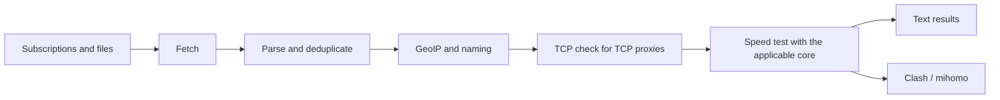

<div align="center">

# proxy-rs

**Find working proxies without the busywork.**

`proxy-rs` collects proxies from subscriptions, checks connectivity and speed, and helps prepare a Clash/mihomo configuration. It runs on Windows, macOS, and Linux.

[](https://github.com/adamantida/proxyRepoChecker-rs/actions/workflows/cross-platform.yml)


[Русский](README.md) · [English](README.en.md) · [简体中文](README.zh-CN.md)

🚀 [Quick start](#quick-start) · 🌐 [Ready-to-use results](#published-results) · 📚 [Documentation](#documentation)

</div>

## ✨ What `proxy-rs` can do



- Parses VLESS, VMess, Trojan, Shadowsocks (`ss`), Hysteria 1, and Hysteria 2 links; speed checks and export follow the capabilities of the corresponding core.
- Accepts local files, individual subscription URLs, and JSON source sets.
- Writes intermediate results atomically so you can inspect each stage.
- Generates Clash/mihomo configuration from proxies that pass the speed threshold.
- Generates sing-box JSON with a report for unsupported settings; measures speed across multiple targets and can report the median and spread.
- Diagnoses a single proxy link with `--check-one FILE`, including core startup, SOCKS readiness, and download.
- Builds on Windows, macOS, and Linux; Xray is selected for the current OS and architecture.

<a id="quick-start"></a>

## 🚀 Quick start

You’ll need stable Rust and Cargo. Clone the repository, then run these commands from its root:

```sh
cargo build --workspace --release
cargo run --release -- --set 3 -n 200 --shuffle
```

The second command is a short run using a small source set and a limit of 200 proxies. For the full list of options, run:

```sh
cargo run -- --help
```

To compare multi-target measurements and export sing-box:

```sh
proxy-rs --file proxies.txt --speed-probes 5 --speed-report speed.json \
  --singbox sing-box.json --singbox-report sing-box-skipped.json --singbox-check
proxy-rs --check-one one-proxy.txt
```

`--singbox-check` validates the generated config with the installed sing-box CLI (`sing-box check`). If the binary is not on `PATH`, pass it with `--singbox-bin FILE`. The speed report includes each target's sanitized result; the source report shows errors and unique, TCP-live, and speed-qualified counts per feed.

### 🛠 Build scripts

Use `scripts/build.sh` from Bash on macOS/Linux and `scripts/build.bat` from Windows `cmd.exe`. Both default to the host platform and can select a platform, architecture, or all platforms:

```sh
# macOS/Linux: host, Linux ARM64, or all platforms for x86_64
scripts/build.sh
scripts/build.sh linux --arch aarch64 --install-target
scripts/build.sh all --arch x86_64
```

```bat
rem Windows cmd.exe: Windows x86_64 or all platforms for ARM64
scripts\build.bat windows --arch x86_64 --install-target
scripts\build.bat all --arch aarch64 --install-target
```

`--install-target` adds only the Rust target with rustup. Cross-compilation also needs a compatible linker and system SDK: Windows GNU needs a MinGW linker, Windows ARM64 needs the MSVC toolchain, and macOS builds need the Apple SDK/toolchain. A build script cannot install these host tools; non-native builds may need Cargo linker configuration. Native binaries are in `target/release/`; cross-builds are in `target/<rust-target>/release/`.

### 🔒 Safer fetching and resume

Subscription TLS certificates are verified by default. Each response is limited to 16 MiB; two delayed retries are the default. The `.proxy_cache` cache uses `ETag`/`Last-Modified` and can fall back to the last successful response during a temporary failure. Set another directory with `--fetch-cache-dir DIR` or disable caching with `--no-fetch-cache`. `--insecure-source-tls` disables certificate verification and should be used only deliberately.

```sh
proxy-rs --url 'https://example.org/sub' --fetch-retries 4 --max-source-bytes 33554432 \
  --source-report source-quality.json --checkpoint run.checkpoint
# Continue from the last saved stage after an interruption:
proxy-rs --resume --checkpoint run.checkpoint
```

`--resume` requires `--checkpoint FILE`. The JSON source report contains per-source status, stage counts, and exact unsupported-feature reasons; credentials, query, fragment, and path are stripped from source URLs. Checkpoints contain links and results needed to resume, so keep the file private.

### 🎛️ Filtering and JSON output

`--protocol` and `--country` keep selected protocols and countries (ISO codes or GeoIP tags); repeat an option or provide comma-separated values. `--only-new` parses outbound keys from the existing `--output` file and removes proxies whose keys are already present. `--json-output FILE` also writes the final alive proxies as a JSON array containing only the summary fields `protocol`, `server`, `port`, `name`, `country`, `display`, `ping_ms`, and `speed_kbs`. It does not include proxy URIs, passwords, UUIDs, or connection settings.

```sh
cargo run --release -- --url 'https://example.org/sub' \
  --protocol vless,vmess --country US,DE --only-new \
  --json-output new-proxies.json
```

## 📂 Output files

| File | Contents |
|---|---|
| `raw.txt` | Text downloaded from subscriptions |
| `parsed.txt` | Unique parsed links; after GeoIP, links include display names |
| `alive.txt` | Final proxies that pass enabled checks; if both TCP and speed checks are disabled, candidates are not connectivity-checked |
| `good.txt` | Proxies that meet the `--min-kb` threshold |
| `dead.txt` | Proxies rejected by TCP, ping limits, or speed checks, when `--dead` is set |
| `clash.yaml` | Clash/mihomo config when `--clash` is set and eligible proxies exist |
| `sing-box.json` | sing-box config when `--singbox` is set and eligible proxies exist |

Use CLI flags to change output paths. Generated results and local logs are excluded from Git.

<a id="documentation"></a>

## 📚 Documentation

- [Полное руководство на русском](docs/ru/README.md)
- [Full documentation in English](docs/en/README.md)
- [简体中文完整文档](docs/zh-CN/README.md)
- [История изменений и релизов / Changelog / 更新日志](CHANGELOG.md)

The manuals cover every CLI option, input data, pipeline stages, output formats, Xray, GeoIP, Clash/mihomo, architecture, tests, and CI.

## 👩‍💻 Development

```sh
cargo fmt --all -- --check
cargo clippy --workspace --all-targets -- -D warnings
cargo test --workspace
cargo build --workspace --release
cargo bench --bench pipeline
```

The workspace tests also run a deterministic fuzz-style corpus of malformed proxy URIs and GeoIP protobuf data. It is seeded regression testing, not a separate coverage-guided fuzzing runtime.

The Ubuntu, macOS, and Windows build/test workflow is available for manual runs. The proxy collector is the only workflow scheduled to run automatically.

## 📦 Releases

Pushing a `vX.Y.Z` tag that matches the version in `Cargo.toml` builds archives for Linux, macOS, and Windows. GitHub Actions attaches SHA-256 checksums and creates a **draft** Release containing the three-language documentation, ready for review and editing before publication.

<a id="published-results"></a>

## 🌐 Ready-to-use results

Open a RAW file to view it or copy its link into your app:

| What you need | File |
|---|---|
| Ready-to-use Clash/mihomo config | [📥 clash.yaml](https://raw.githubusercontent.com/adamantida/proxyRepoChecker-rs/dist/clash.yaml) |
| Proxies that passed the speed check | [⚡ good.txt](https://raw.githubusercontent.com/adamantida/proxyRepoChecker-rs/dist/good.txt) |
| All proxies after enabled checks | [✅ alive.txt](https://raw.githubusercontent.com/adamantida/proxyRepoChecker-rs/dist/alive.txt) |
| Proxies rejected by checks | [🧾 dead.txt](https://raw.githubusercontent.com/adamantida/proxyRepoChecker-rs/dist/dead.txt) |

Publishing runs every 60 minutes, and can also be started manually from [GitHub Actions](https://github.com/adamantida/proxyRepoChecker-rs/actions/workflows/proxy-collection.yml). New files appear after a successful check; if a run fails, the current links keep serving the previous results. GitHub may delay scheduled runs during periods of high load.

## 💬 uSphere VPN

Looking for a ready-to-use VPN for everyday browsing? Try **uSphere VPN**, a paid service we recommend for its quality. Visit the Telegram bot to review the terms and choose an option that works for you:

[Visit uSphere VPN on Telegram →](https://t.me/uSphereVPN_bot)

## 📄 License

This project is distributed under the [MIT License](LICENSE).
