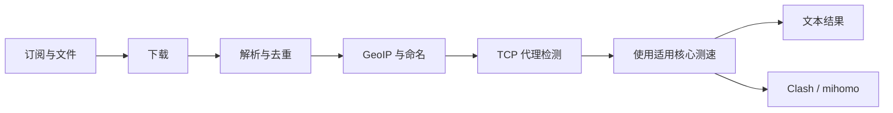

<div align="center">

# proxy-rs

**轻松找到可用代理，少做重复工作。**

`proxy-rs` 从订阅中收集代理，检查连通性和速度，并帮助生成 Clash/mihomo 配置。支持 Windows、macOS 和 Linux。

[](https://github.com/adamantida/proxyRepoChecker-rs/actions/workflows/cross-platform.yml)


[Русский](README.md) · [English](README.en.md) · [简体中文](README.zh-CN.md)

🚀 [快速开始](#quick-start) · 🌐 [可直接使用的结果](#published-results) · 📚 [文档](#documentation)

</div>

## ✨ `proxy-rs` 可以做什么



- 解析 VLESS、VMess、Trojan、Shadowsocks（`ss`）、Hysteria 1 和 Hysteria 2 链接；测速与导出受相应核心的实际能力限制。
- 支持本地文件、单个订阅 URL，以及 JSON 中定义的订阅集合。
- 中间结果采用原子写入，可在每个阶段后查看。
- 根据速度阈值筛选代理并生成 Clash/mihomo 配置。
- 生成 sing-box JSON，并提供不支持配置的报告；使用多个测速目标并可报告中位数和速度范围。
- 通过 `--check-one FILE` 诊断单个代理链接，包括核心启动、SOCKS 就绪和下载阶段。
- 支持 Windows、macOS 和 Linux，并按当前系统及架构选择 Xray。

<a id="quick-start"></a>

## 🚀 快速开始

需要安装 Rust stable 和 Cargo。克隆仓库后，在项目根目录运行：

```sh
cargo build --workspace --release
cargo run --release -- --set 3 -n 200 --shuffle
```

第二条命令使用较小的来源集合，最多检查 200 个代理，适合快速试运行。查看完整参数列表：

```sh
cargo run -- --help
```

使用多个测速目标并导出 sing-box：

```sh
proxy-rs --file proxies.txt --speed-probes 5 --speed-report speed.json \
  --singbox sing-box.json --singbox-report sing-box-skipped.json --singbox-check
proxy-rs --check-one one-proxy.txt
```

`--singbox-check` 使用已安装的 sing-box CLI（`sing-box check`）验证生成的配置。若程序不在 `PATH` 中，请通过 `--singbox-bin FILE` 指定。测速报告记录每个目标的脱敏结果；来源报告按订阅显示错误原因及唯一、TCP 可达和速度达标节点数。

### 🛠 构建脚本

macOS/Linux 请在 Bash 中使用 `scripts/build.sh`；Windows 请在 `cmd.exe` 中使用 `scripts/build.bat`。默认构建当前平台，也可指定平台、架构或一次构建所有平台：

```sh
# macOS/Linux：当前平台、Linux ARM64，或为 x86_64 构建全部平台
scripts/build.sh
scripts/build.sh linux --arch aarch64 --install-target
scripts/build.sh all --arch x86_64
```

```bat
rem Windows cmd.exe：Windows x86_64，或为 ARM64 构建全部平台
scripts\build.bat windows --arch x86_64 --install-target
scripts\build.bat all --arch aarch64 --install-target
```

`--install-target` 只通过 rustup 安装 Rust target。交叉编译还需要匹配的 linker 和系统 SDK：Windows GNU 需要兼容的 MinGW linker，Windows ARM64 需要 MSVC 工具链，macOS 构建需要 Apple SDK/toolchain。脚本不会自动安装这些系统工具；非本机目标可能需要配置 Cargo linker。本机二进制位于 `target/release/`，交叉编译产物位于 `target/<rust-target>/release/`。

### 🔒 安全下载与断点续跑

默认验证订阅的 TLS 证书。每个响应默认最多 16 MiB，临时错误会延迟重试两次。`.proxy_cache` 使用 `ETag`/`Last-Modified`，并可在临时网络错误时回退到上次成功的响应；使用 `--fetch-cache-dir DIR` 更改目录，或用 `--no-fetch-cache` 关闭缓存。`--insecure-source-tls` 会关闭证书验证，只应在明确接受风险时使用。

```sh
proxy-rs --url 'https://example.org/sub' --fetch-retries 4 --max-source-bytes 33554432 \
  --source-report source-quality.json --checkpoint run.checkpoint
# 中断或失败后从已保存阶段继续：
proxy-rs --resume --checkpoint run.checkpoint
```

`--resume` 必须同时指定 `--checkpoint FILE`。JSON 来源报告包含各订阅的状态、阶段计数和具体的不支持原因；来源 URL 中的凭据、查询参数、fragment 和路径会被隐藏。Checkpoint 保存续跑所需的链接和结果，请将文件保存在私密位置。

### 🎛️ 筛选与 JSON 输出

`--protocol` 和 `--country` 可保留指定协议及国家（ISO 代码或 GeoIP 标签）；同一参数可重复使用，也可用逗号分隔多个值。`--only-new` 会解析现有 `--output` 文件中的 outbound key，并移除 key 已存在的代理。`--json-output FILE` 还会将最终存活代理写成 JSON 数组，只包含摘要字段：`protocol`、`server`、`port`、`name`、`country`、`display`、`ping_ms` 和 `speed_kbs`；不包含代理 URI、密码、UUID 或连接设置。

```sh
cargo run --release -- --url 'https://example.org/sub' \
  --protocol vless,vmess --country US,DE --only-new \
  --json-output new-proxies.json
```

## 📂 输出文件

| 文件 | 内容 |
|---|---|
| `raw.txt` | 从订阅下载的原始文本 |
| `parsed.txt` | 去重后的代理链接；GeoIP 阶段后会带显示名称 |
| `alive.txt` | 通过已启用检查的最终代理；若同时关闭 TCP 和速度检查，候选节点尚未经过连通性验证 |
| `good.txt` | 达到 `--min-kb` 速度阈值的代理 |
| `dead.txt` | 被 TCP、延迟上限或速度检查淘汰的代理；需指定 `--dead` |
| `clash.yaml` | 指定 `--clash` 且存在符合条件的代理时生成的配置 |
| `sing-box.json` | 指定 `--singbox` 且存在符合条件的代理时生成的配置 |

可通过 CLI 参数修改输出路径。生成结果和本地日志已从 Git 跟踪中排除。

<a id="documentation"></a>

## 📚 文档

- [Полное руководство на русском](docs/ru/README.md)
- [Full documentation in English](docs/en/README.md)
- [简体中文完整文档](docs/zh-CN/README.md)
- [История изменений и релизов / Changelog / 更新日志](CHANGELOG.md)

完整手册包含全部 CLI 参数、输入数据、处理流程、输出格式、Xray、GeoIP、Clash/mihomo、项目结构、测试和 CI。

## 👩‍💻 开发

```sh
cargo fmt --all -- --check
cargo clippy --workspace --all-targets -- -D warnings
cargo test --workspace
cargo build --workspace --release
cargo bench --bench pipeline
```

Workspace 测试还会运行确定性的 fuzz-style 测试语料，覆盖损坏的代理 URI 和 GeoIP protobuf 数据。这是带固定随机种子的回归测试，不是独立的覆盖引导 fuzzing runtime。

Ubuntu、macOS 和 Windows 的构建与测试 workflow 可手动运行。代理收集器是唯一按计划自动运行的 workflow。

## 📦 发布版本

推送与 `Cargo.toml` 版本号一致的 `vX.Y.Z` 标签后，GitHub Actions 会为 Linux、macOS 和 Windows 构建压缩包，附加 SHA-256 校验和，并创建包含三种语言文档的 **Release 草稿**，供发布前检查和编辑。

<a id="published-results"></a>

## 🌐 可直接使用的结果

点击 RAW 链接即可查看文件，也可以复制链接到客户端中使用：

| 用途 | 文件 |
|---|---|
| 可直接导入 Clash/mihomo 的配置 | [📥 clash.yaml](https://raw.githubusercontent.com/adamantida/proxyRepoChecker-rs/dist/clash.yaml) |
| 通过速度检查的代理 | [⚡ good.txt](https://raw.githubusercontent.com/adamantida/proxyRepoChecker-rs/dist/good.txt) |
| 通过已启用检查的全部代理 | [✅ alive.txt](https://raw.githubusercontent.com/adamantida/proxyRepoChecker-rs/dist/alive.txt) |
| 检查未通过的代理 | [🧾 dead.txt](https://raw.githubusercontent.com/adamantida/proxyRepoChecker-rs/dist/dead.txt) |

发布 workflow 每 60 分钟运行一次，即；也可在 [GitHub Actions](https://github.com/adamantida/proxyRepoChecker-rs/actions/workflows/proxy-collection.yml) 中手动启动。成功检查后才会更新文件；如果运行失败，现有链接仍会提供上一版结果。GitHub 负载较高时，计划任务可能稍有延迟。

## 💬 uSphere VPN

想找一款适合日常使用的 VPN 服务？欢迎了解 **uSphere VPN**。这是一项付费服务，项目维护者认可其服务品质。请前往 Telegram 机器人查看服务条款并选择适合自己的方案：

[前往 Telegram 了解 uSphere VPN →](https://t.me/uSphereVPN_bot)

## 📄 许可证

本项目依据 [MIT 许可证](LICENSE) 发布。
